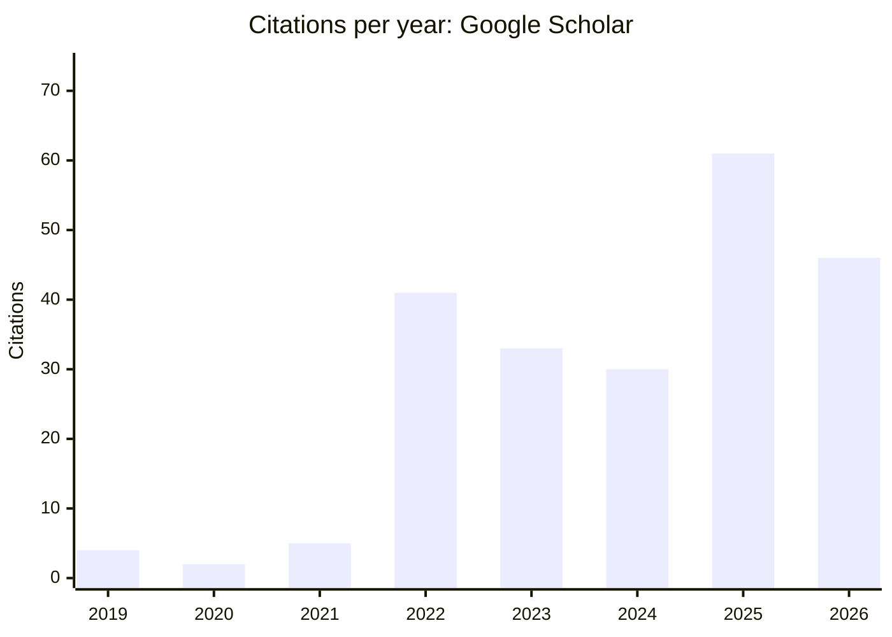
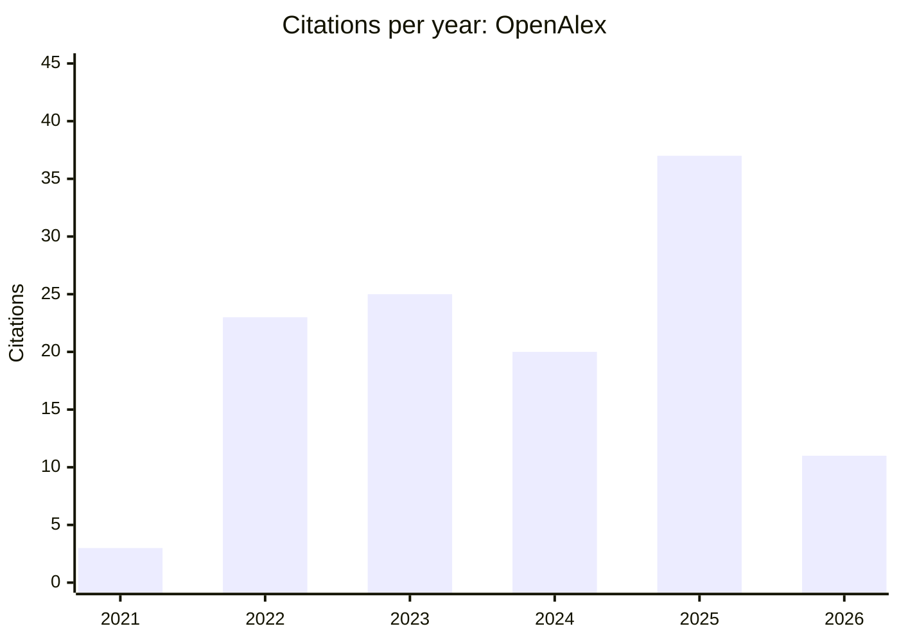

# Research Metrics: Source Review

> Phase 2 · Ibrahim Taha Axiom · generated 2026-11-05T20:18:50+00:00 by `scripts/ingestion/s08_reports.py`
> **Not yet reviewed by the researcher.** Committed to the repository with the project owner's approval (2026-11-05). Nothing here goes on the public website until the researcher approves it. Personal contact data is deliberately excluded.

**Rules applied:** every number carries its platform, URL and retrieval time. Figures from different platforms are **never mixed or relabelled**. Derived values are labelled as estimates. There is one snapshot per date (`data-staging/metrics/2026-11-05/`), and earlier dates are never overwritten. Research impact is kept separate from website traffic and from community reach.

## Google Scholar (profile VgoxbyYAAAAJ, retrieved 2026-11-05T19:58:50+00:00)
| Metric | Value | Scope | Retrieved |
|---|---|---|---|
| citation count (all) | 226 | Google Scholar profile VgoxbyYAAAAJ | 2026-11-05T19:58:50+00:00 |
| citation count (Since 2021) | 218 | Google Scholar profile VgoxbyYAAAAJ | 2026-11-05T19:58:50+00:00 |
| h-index (all) | 7 | Google Scholar profile VgoxbyYAAAAJ | 2026-11-05T19:58:50+00:00 |
| h-index (Since 2021) | 6 | Google Scholar profile VgoxbyYAAAAJ | 2026-11-05T19:58:50+00:00 |
| i10-index (all) | 5 | Google Scholar profile VgoxbyYAAAAJ | 2026-11-05T19:58:50+00:00 |
| i10-index (Since 2021) | 4 | Google Scholar profile VgoxbyYAAAAJ | 2026-11-05T19:58:50+00:00 |

*Source: Google Scholar profile citation chart, 2026-11-05. Coverage: Google Scholar index, 2019–2026; 2026 is partial.*

## OpenAlex (author A5102868128)
| Metric | Value | Scope | Retrieved |
|---|---|---|---|
| works count | 9 | author A5102868128 | 2026-11-05T19:57:47+00:00 |
| citation count | 119 | author A5102868128 | 2026-11-05T19:57:47+00:00 |
| h-index | 4 | author A5102868128 | 2026-11-05T19:57:47+00:00 |
| i10-index | 2 | author A5102868128 | 2026-11-05T19:57:47+00:00 |
| 2-year mean citedness | 1.2 | author A5102868128 | 2026-11-05T19:57:47+00:00 |

*Source: OpenAlex `counts_by_year` for author A5102868128. Coverage: 9 indexed works; 2026 is partial.*

## Semantic Scholar (author 2142163895)
| Metric | Value | Scope | Retrieved |
|---|---|---|---|
| paper count | 8 | author 2142163895 | 2026-11-05T20:12:03+00:00 |
| citation count | 123 | author 2142163895 | 2026-11-05T20:12:03+00:00 |
| h-index | 3 | author 2142163895 | 2026-11-05T20:12:03+00:00 |
Caveat: this profile includes one misattributed 1970 record, and one genuine paper sits under a different author ID.

## Derived (this catalog)
- **h-index estimate = 4**: h = max h such that h works have >= h OpenAlex citations; scope: 9 authorship-verified DOI works in this catalog. Estimate over verified DOI works only; not comparable with Google Scholar's h-index.

## Per-work citations by source (not summed across sources)
| ID | Title | Google Scholar | OpenAlex | Crossref |
|---|---|---|---|---|
| pub-0002 | Beta ridge regression estimators: simulation and application | 86 | 61 | 52 |
| pub-0010 | A New Two-Parameter Estimator for Beta Regression Model: Me… | 67 | 41 | 35 |
| pub-0011 | A new biased estimator for zero-inflated count regression m… | 18 |  |  |
| pub-0007 | The Role of Environmental Monitoring in Promoting Green Cre… | 14 | 7 | 5 |
| pub-0012 | Ridge estimators for the negative binomial regression model… | 12 |  |  |
| pub-0003 | A Note on Prior Selection in Bayesian Estimation | 9 | 3 | 2 |
| pub-0013 | New shrinkage parameters for Liu-type zero inflated negativ… | 8 |  |  |
| pub-0008 | The Impact of Students’ Cybersecurity Vulnerability Behavio… | 6 | 3 | 1 |
| pub-0014 | A Comprehensive Guide to the ARDL Bounds Testing Approach f… | 2 |  |  |
| pub-0015 | Handling Multicollinearity Problem in Generalized Linear Mo… | 2 |  |  |
| pub-0005 | Using TAM to Evaluate the Effect of intensive usage of Digi… | 1 |  | 1 |
| pub-0006 | Using TAM to Evaluate the Effect of Intensive Usage of Digi… | 1 | 4 | 0 |
| pub-0016 | A Comprehensive Guide to the ARDL Bounds Testing Approach f… | 1 |  |  |
| pub-0001 | An analytical family of correlation-weighted elastic-net es… |  |  | 0 |
| pub-0004 | Development of Penalized Estimation for Conway-Maxwell-Pois… |  | 0 | 0 |
| pub-0009 | The moderating role of green human resource management prac… |  | 0 | 0 |

## Why the platforms disagree
- Google Scholar indexes more document types (guides, theses, conference papers, preprints) and counts citations from them, so it is the highest (226 vs 119 OpenAlex).
- OpenAlex covers 9 DOI works and only citing works it can match. Crossref counts only citing works with deposited references.
- Each platform's h-index is only valid for that platform's coverage.

## Recommendation for the website (to approve)
Show a small, **dated and source-labelled** metrics block, e.g. "Google Scholar: 226 citations, h-index 7 (as of 2026-11-05)", with a link to the profile, plus OpenAlex figures as the reproducible open-data reference. Refresh via the scheduled job (architecture §3). Do **not** display self-reported journal quartiles (Q1/Q2) unless they are sourced from SJR or JCR with a year.

## Community reach (not a research metric)
Telegram: 46,523 members observed (2026-11-05). Facebook page and group figures are self-reported (390,000+ / 118,000+) and could not be verified.
