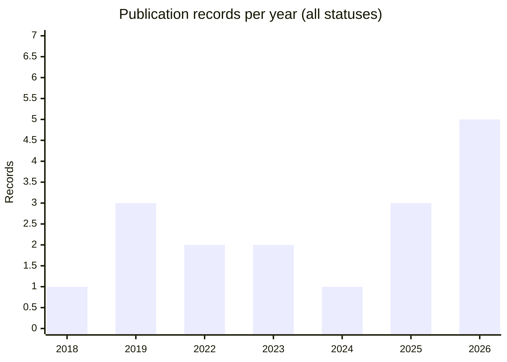
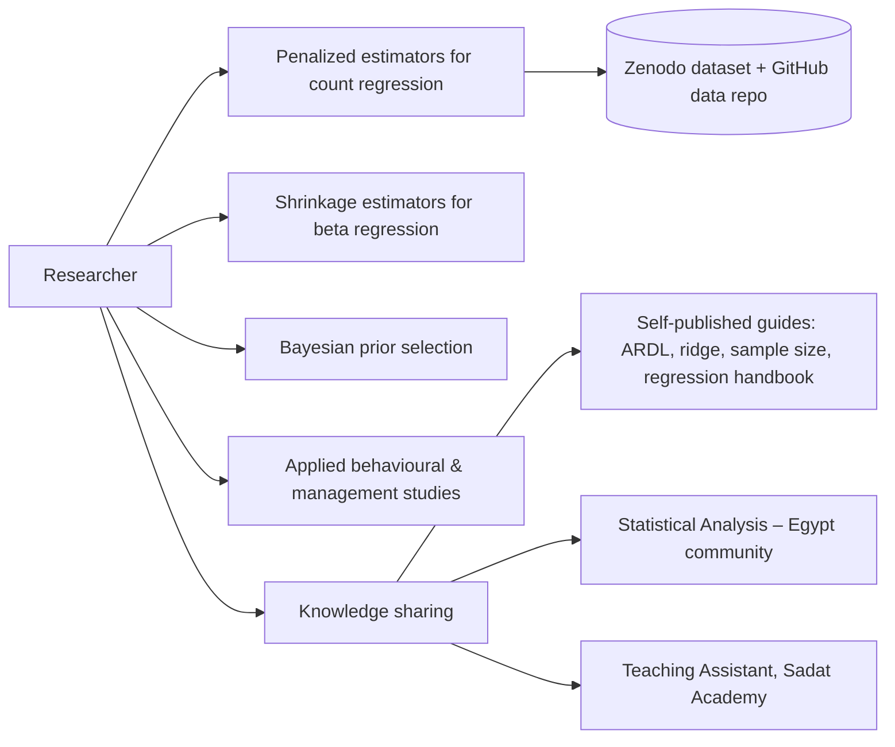

# Research Portfolio Analysis

> Phase 2 · Ibrahim Taha Axiom · generated 2026-11-05T20:18:50+00:00 by `scripts/ingestion/s08_reports.py`
> **Not yet reviewed by the researcher.** Committed to the repository with the project owner's approval (2026-11-05). Nothing here goes on the public website until the researcher approves it. Personal contact data is deliberately excluded.

> Scope: 17 publication records (any status) and 9 authorship-verified DOI works. Counts that include candidates are marked. None of this is a definitive bibliometric profile.

## A. Research output overview

*Source: this catalog (Crossref, OpenAlex, ORCID, Google Scholar first page, earlier site), 2026-11-05. Includes candidates; 0 record(s) without a year are not plotted.*

| Year | verified | conflicted | candidate | incomplete |
|---|---|---|---|---|
| 2018 | 0 | 0 | 0 | 1 |
| 2019 | 0 | 0 | 2 | 1 |
| 2022 | 1 | 1 | 0 | 0 |
| 2023 | 1 | 1 | 0 | 0 |
| 2024 | 0 | 1 | 0 | 0 |
| 2025 | 1 | 0 | 2 | 0 |
| 2026 | 3 | 0 | 2 | 0 |

**Types (verified DOI works only):** 9 journal articles. **Candidates add:** 1 more journal article (JMASM 2019), 2 conference papers, 1 Master's thesis and 4 self-published guides.

**Venues (verified):**
| Venue | Works |
|---|---|
| Statistics, Optimization & Information Computing | 2 |
| Journal of Statistical Computation and Simulation | 1 |
| Communications in Statistics - Simulation and Computation | 1 |
| مجلة الجمعیة المصریة لنظم المعلومات وتکنولوجیا الحاسبات | 1 |
| Economics and Business | 1 |
| Organizacija | 1 |
| Production Engineering Archives | 1 |
| Frontiers in Applied Mathematics and Statistics | 1 |

**Publishers (verified):** Informa UK Limited (2), International Academic Press (2), Egypts Presidential Specialized Council for Education and Scientific Research (1), Riga Technical University (1), Walter de Gruyter GmbH (1), Stowarzyszenie Menedzerow Jakosci i Produkcji (1), Frontiers Media SA (1)

**Open access (verified, OpenAlex):** null: 1, closed: 1, diamond: 4, bronze: 1, gold: 2

**Topics (OpenAlex primary topic, machine-assigned, verified works):**
| Field | Subfield | Works |
|---|---|---|
| Mathematics | Statistics and Probability | 4 |
| Business, Management and Accounting | Marketing | 2 |
| Decision Sciences | Information Systems and Management | 1 |
| Computer Science | Information Systems | 1 |

**Most-cited works, by source (not merged):**
- **Google Scholar:** Beta ridge regression estimators: simulation and appli… (86); A New Two-Parameter Estimator for Beta Regression Mode… (67); A new biased estimator for zero-inflated count regress… (18)
- **OpenAlex:** Beta ridge regression estimators: simulation and appli… (61); A New Two-Parameter Estimator for Beta Regression Mode… (41); The Role of Environmental Monitoring in Promoting Gree… (7)
- **Crossref:** Beta ridge regression estimators: simulation and appli… (52); A New Two-Parameter Estimator for Beta Regression Mode… (35); The Role of Environmental Monitoring in Promoting Gree… (5)

## Collaboration patterns (verified works)
- Distinct co-authors: **12**. Researcher's position: first 4, last 3, middle 2.
- Most frequent co-authors: Mohamed R. Abonazel (4), Ali Abdulhassan Abbas (3), Amany M. Mousa (2), Muhammad M. Seliem (1), Amr R. Kamel (1).
- Two clusters: a **methodology** cluster with Cairo University statisticians (Abonazel, Mousa, Rady, Seliem, Kamel) and an **applied management** cluster with University of Kerbala colleagues (Abbas, Shyaa, Abd Ali).

## B. Research portfolio map (inferred; for the researcher to confirm)

| Line | Linked publications | Status |
|---|---|---|
| Penalized / shrinkage estimators for count regression (negative binomial, zero-inflated, Conway-Maxwell-Poisson) | pub-0012, pub-0013, pub-0011, pub-0004, pub-0001 | candidate |
| Shrinkage estimators for beta regression | pub-0002, pub-0010 | candidate |
| Bayesian estimation (prior selection) | pub-0003 | candidate |
| Applied behavioural / management studies (TAM, green creativity, cybersecurity behaviour, green HRM; SEM-based) | pub-0006, pub-0007, pub-0008, pub-0009 | candidate |

*Research lines are inferred from topics and co-authorship. No documented projects (grants, project pages) were found.*
